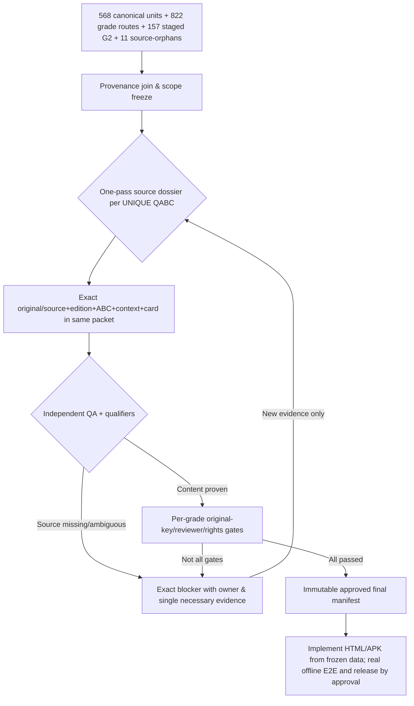

# ANRE Trainer | ONE PASS v2 | FINAL CONTENT VALIDATION + COMPLETE CARD + SOURCE + ORIGINAL-KEY QA

**Proposal date:** 2026-11-23. **State:** DESIGN/RESEARCH ONLY; no review/release gate has been promoted by writing this plan. `audit/anre-v8-priority-17-20261109`; PR #7 stays Draft/unmerged. Parent protocol: [ONE_PASS_VALIDATION_MAPPING_PROTOCOL_V1_2026_11_13.md](./INTEGRATED_ADJUDICATION_2026_11_13/ONE_PASS_VALIDATION_MAPPING_PROTOCOL_V1_2026_11_13.md). Parent latest: CKPT-407.

## 0. Verified existing assets and baseline, BEFORE proposing new work

| Source in repo (exact branch as of proposal) | What is actually substantiated | What is NOT substantiated |
| --- | --- | --- |
| `V241_568_QABC_ALL_FULL_ABC_822_GRADE_ROUTES_4_VERSION_HOLDS_2026_11_21.json` | 568/568 complete A/B/C **editorial draft** layers; 822/822 current grade routes covered by draft; 6 strict source/key hold units, 136 semantic caveat flags accumulated historically | 568 complete source-licensed before/focus/after cards or independently scored keys |
| `INTEGRATED_ADJUDICATION_2026_11_13/MASTER_UNIT_CARDS_568.csv` | 568 rows; only 15 have the source/document/section, ABC adjudication and context explanation fields populated, 11 have a short source quotation | This is a **stale aggregate**, so not evidence that newer staged V241 and V247+ context does not exist |
| `INTEGRATED_ADJUDICATION_2026_11_13/GRADE_RELEASE_LEDGER_822.csv` | 822 rows; 0/822 final approvals; each has separate grade/key/status | Any independent professional/official-key signoff |
| `V291_822_ROUTE_PROFESSIONAL_APPROVAL_MATRIX_AFTER_P1_TRIAGE_2026_11_22.csv` | Current canonical split 414 Grade I + 408 Grade II; 27 P0, 2 P1, 793 P2; all signoff NO | Any proof that the historical P2 cases have been adjudicated in the final review |
| `V294_GFR_568_ORIGIN_822_KEYS_415_XLSX_153_DIDACTIC_BIAS_11_SOURCE_ORPHANS_2026_11_22.json` | 415 source-native canonical QABC groups, 153 **unofficial didactic** QABC, each with A imported key; 4 materially altered original QABC; 11 original Electrotehnica source rows not represented in older map (9 graphic/figure, 2 text). 153 synthetic items require randomisation and reliability test | That all 568 are official exam questions, or 153 identical A slots are proven and unbiased |
| `V297_G2_304_NATIVE_VS_822_COVERAGE_149_ABSENT_8_VARIANTS_2026_11_22.json` | Of 304 original Grade-II source rows, 147 source-exact in canonical, 8 same stem but different A/B/C, 149 absent stems; source candidates vs canonical require reconciliation | That all 149 are uniquely new questions, or all 822 cover every original G2 question |
| `V300_G2_RECOVERY_157_STAGING_INVARIANTS_QA_2026_11_22.json` | 157 original G2 candidates (149 missing stems + 8 altered variants) have been staged and original A/B/C matched; user already **approved future inclusion when validated**; 157 not promoted and no key assigned | That existing 822 can be called final full source coverage, or 157 can be auto-merged; 979 is **maximum hypothetical** not approved target |
| `V355...V359` and CKPT-407 | New preliminary independent AI source challenges, scoped source corrections and semantic safeguards | Qualified electrician/legal/linguist signoff or authentic official scored ANRE key |

**External source identity and edition checked 2026-11-23**:
- [ANRE's current site resources](https://anre.ro/participanti-la-piata-de-energie/persoane-fizice/energie-electrica/) publicly link 2023 syllabus, 2024 Electro, 2023 Grade-I/II legal/norm XLSX examples. Published [syllabus dated May 2023](https://anre.ro/wp-content/uploads/2023/05/Tematica-si-bibliografie-pentru-examenul-de-autorizare-electricieni-2023-.pdf) includes I7 for Grades I/II, PE102/1986 for Grade **II** but **not Grade I**, PE155 for both; 2026-session edition/source validity remains a separate authentication gate. The ANRE example XLSX does NOT by itself prove an official scored key. Locate 2026 modifications at [Romanian legislative portal](https://legislatie.just.ro/) and official ANRE documents, not search-result snippets.
- QA architecture inspired by [ISO/IEC/IEEE 29119-2:2021](https://www.iso.org/standard/79428.html) test process, [29119-3:2021](https://www.iso.org/standard/79429.html) test evidence/traceability and [NIST AI RMF MEASURE](https://airc.nist.gov/airmf-resources/playbook/measure/) emphasis on provenance, human oversight, documented go/no-go. This process is **NOT ISO-certified**.

## Objective / Definition of Done

At the end, every **in-scope original grade route** is traceable to exactly one preserved original question and immutable original A/B/C and key, one justified technical/source adjudication **or explicit no-unique-key diagnosis**, one explanatory card (with proper context rights), versioned evidence and separate QA disposition. All grade routes intended for **scored learning** must have `APPROVED_FOR_LEARNING=true` with a real qualified independent reviewer/owner-gate proof, with zero unexplained source/bibliography/ABC/citation/image ambiguity. Where ANRE publishes no scored key, state `OFFICIAL_KEY_NOT_AUTHENTICATED` separately from `TECHNICALLY_SOURCE_VALIDATED`. Never use official-key authenticity as a fabricated proxy for technical validity; never claim official ANRE scoring without documentary proof.

**Freeze scope before final grade approvals**: Start with canonical 568 QABC / 822 routes. Reconcile user-approved **157 original G2 staging candidates**, **11 omitted original Electrotehnica source rows**, four canonical source mutations, and 153 unofficial didactic units. Decide per candidate **dedupe / original-variant separate ID / replace only after permission / add after full validation / out of current exam syllabus / teaching-only**. Produce a source-native proposed final count *computed from approved mappings*, not presume 822 or 979. Existing 822 remain intact until explicit change permission.

## Exactly three execution phases: no repeated 822-question research loops

### Phase 1. INVENTORY + SOURCE-OF-TRUTH JOIN + PILOT (no answer/app modifications)

- Make a new `FINAL_EVIDENCE_MASTER_V2` by **JOIN**, not by overwriting any V141/V241/old ledger: canonical 568 unit IDs, 822 grade route IDs, raw original workbook + original row/sha + A/B/C + imported key; latest V241 draft and V247+/V359 source/contexts; official ANRE 2023 workbook fidelity; final 2026 applicable source versions, qualified review flags; staged 157 separately indexed; 11 source orphans. Each field gets provenance `repo_path:blobSHA:record_id` and `checked_on` + source version `hash`.
- A **source availability matrix** across G1/G2/Electrotehnica/Norme/Legislație, verifying source ID, original stem/options including numerically formatted cells, embedded original figures, table/diagram, page, edition, source-rights. Distinguish `source_url_exists`, `source_text_retrieved`, `source_scope_matched`, `quote_verified`, `grade_edition_verified`; they are separate booleans. A search URL alone is NOT a verified source. No extracted images or standards copied into GitHub absent rights.
- Compute a mechanical `GAP_REPORT` from all in-scope units: exact counts **already proven / missing source / edition mismatch / missing original figure / missing before-focus-after / A/B/C conflict / card missing / grade mismatch / professional review missing / user decision needed**. Do not report summation across overlapping flags as unique questions. Maintain separate `source_groups`, `grade_routes`, `critical_hold_roots` counts.
- **Pilot 12 representative preexisting cases** to verify the v2 join and final artifact shape, without crediting previously researched questions as NEW research: shared G1+G2, original-source legal changed in 2026, PE102 grade-dependent, I7 959/2023 amendment, numeric calculation, diagram / nine original graphics, 153 didactic-A item, original/Trainer A/B/C mutation, 'numai/obligatoriu' linguistic trap, two true options, no unique key, source rights unavailable. Require exact field-to-field alignment and zero false approval. If any mismatch, fix pipeline before mass batches.

**Phase-1 exit:** Every existing unit, route and staged source candidate has an exact and unique inventory row and evidence status. **0 unknown provenance/duplicates.** Final candidate bank scope is frozen or has a named, separate import gate; no editing QABC/keys/HTML/APK.

### Phase 2. ONE ATOMIC SOURCE VISIT PER UNIQUE QABC: ANSWER + CARD + QA, together

Create an immutable **evidence packet per 568 unique unit**, reusing prior work first, and per accepted new source-native unit after scope resolution. Process a unit once, **only reopen source on a named unsatisfied gap**, not because another checkpoint starts. Validate grade-route edition/key separately for every shared ID.

For each packet, IN THE SAME source visit:

1. **Original and source scope:** original workbook original cell values/formatted displays/figures + SHA; source legal/technical object, action, conditions, date, **grade/edition**, preceding/following clause, exceptions and competing exact-scope rule (e.g. PE155 branch column ≠ generic I7 tube; PE102 circuits ≠ I7 apparatus). Record exact locator/URL/source snapshot/hash. Do not silently substitute the current law when source is historical; explain the applicable exam era.
2. **ABC adjudication + teaching simultaneously:** For each A/B/C, test affirmative textual/mathematical proof, explicit counterexample, absolute modifiers `numai`, `nu`, `trebuie`, `poate`, `cel mult` vs `cel puțin`, source exception, units, numeric tolerances, symbols, diagram/topology. Compare A↔B↔C and stem↔each option. If two answers can be literally correct, **NO_UNIQUE_ANSWER**. Preserve imported key and user's interpretation as separate historical fields. Distinguish `candidate_key`, `imported_key`, `official_scored_key` and `technical_source_conclusion`; never update official/embedded key without explicit reviewed authorization.
3. **Finish card at the same time:** 3 separate A/B/C explanations, didactic rephrased practice question (tag unofficial), source document/edition/locator, **original real previous context + exact focus bold + original following context**, expanded exception, figure/table ID, correct offline local anchor where licensable, rights/status/alternative original editorial explanation. No invented or fabricated contiguous citations. For copyrighted PE standards/book pages only reproduce permitted very short verbatim excerpts and *original editorial explanation* with precise locators; mark `FULL_VERBATIM_CONTEXT_NOT_PERMITTED` and handle rights, no fake complete verbatim card. Make card display conditional on actual source permission and availability.
4. **Independent review on this packet, not separate research round:** a technical reviewer, source/edition reviewer and linguistic skeptic independently inspect ORIGINAL text, source object and A/B/C. Two AI models checking the same draft are marked `AI_CHALLENGE`, **not** `PROFESSIONAL_SIGNOFF`. Actual qualified reviewer/owner decision carries signed audit evidence `reviewer_role, date, evidence_hash, decision`. A qualified reviewer is required to honestly call the already-mandated final gate satisfied; if not accessible, flag `READY_FOR_QUALIFIED_REVIEW`, do not claim `APPROVED_FOR_LEARNING`. User gets only materially undecidable questions with exact A/B/C + actual before/focus/after permitted original and opposing arguments; their contribution is an **explicit hypothesis** pending technical verification unless they assume a separately defined approval role.
5. **Atomic state write + negative tests:** append-only case revision, no key edits; `PASS_SOURCE_ONLY`, `PASS_TECH_CONTENT_PENDING_SIGNOFF`, `PASS_CARD_CONTENT_PENDING_RIGHTS`, `BLOCKED_EXACT_SOURCE`, `BLOCKED_EDITION`, `BLOCKED_MULTI_TRUE`, `BLOCKED_NO_TRUE`, `BLOCKED_IMAGE`, `BLOCKED_KEY_CONFLICT`, `READY_FOR_QUALIFIED_REVIEW`, `APPROVED_FOR_LEARNING` (gated). When a conclusion is contradicted, link `supersedes_evidence_id` and name *which evidence changed*; never revisit an unchanged blocker in the next batch.

**Batch flow:** small batches by **distinct canonical QABC**, dynamically sorted by actual missing evidence and shared source paragraph, not always 20/25 random questions. Reuse one verified I7 clause for multiple questions without sharing incorrect conclusion; per-question ABC and grade tests are still distinct. Publish completion metrics **unique units genuinely advanced from status X to Y**, `READY_FOR_REVIEW`, blocked causes with owner, grade routes eligible, and user-pending IDs; 0 progress if no state changed.

### Phase 3. INDEPENDENT RELEASE GATE + DATA FREEZE + APPLICATION HANDOFF

- Run deterministic reconciliation with original workbook bytes (when available locally; existing registry hashes alone are **NOT** original binary re-verification) and latest V241/V2 source+card registry: full q/text/A/B/C exactness, grade ID integrity, original key maps, `unit_id` and stable option identity; all source fields correctly aligned (not rotated into other semantic columns). Schema validator checks no missing source doc, edition, before/focus/after where permitted, card explanations, offline anchors/rights; false source URLs, inaccessible docs, changed law edition, attached diagrams all fail closed. Respect intentional source versus didactic distinction.
- **Adversarial/negative suite**: 4 original XLSX material mutations; 153 all-imported-A didactic positional bias (do not auto-rewrite answer keys; display randomization must preserve answer identity); 11 missing original Electrotehnica rows (9 visual, 2 textual); Grade-II original 157 staging; shared-G1/G2 key contradictions; NOR032 PE155 15 m vs generic I7 25 m; NOR-R0037 PE102 circuits vs I7 apparatus; NOR-R0122 'numai Cu'; NOR-R0180 no affirmative B; LEG-R0098 two true documents; law historic/current; images/scans; fake source-context; one/both/no-true ABC; numeric < vs ≤; offline rights. Generate regression tests from every identified real error, plus synthetic false-positive/false-negative fixtures. Keep QA proof distinct from a real HTML/APK E2E run.
- For **scored learning** require one review decision per final grade-route with source-validated technical answer, unambiguous key or expressly adjudicated official document, independently qualified QA, source/edition applicable, legally usable offline card and working source/figure mapping. If no official scored ANRE key exists, classify `TECHNICALLY_VALIDATED_NOT_OFFICIAL_KEY`, never `OFFICIAL_ANRE_KEY_PROVEN`; expert review may establish pedagogic correctness but not the unpublished official key. User-owned didactic 153 get explicit `UNOFFICIAL_PRACTICE` badge and technically validated content, not misleading ANRE provenance.
- **Handoff with zero open gates in the selected scored dataset**: `RELEASE_MANIFEST` lists exact frozen content commit, grade routes, provenance, content SHA, card assets rights, identity mapping, tests and approvals; **newly staged 157/11 must either be accounted for in the final scoped cohort or explicitly listed outside with why**, never silently ignored. Only *after* this handoff implement source/card integrations and run REAL HTML + Android APK offline E2E: grade switching, A/B/C scoring, randomized alternatives, 'repetă greșelile', 'Reținut', offline popup anchor/context, source/table/figures, phone layout, close/reopen and restore state. Real runtime E2E is part of application release, **not** proof that source answers are correct. Keep stable and PR #7 unmerged pending user approval.

**Global invariants:**
- Technical source truth ≠ original ANRE exam scored key ≠ author's didactic guess. Log all three separately.
- **No user ping for routine progress**; ask only specific unresolved semantic/bibliographic/legal/rights decisions. For each unresolved case give original question A/B/C + exact source object/edition + why variants conflict + the next necessary evidence. Preserve user insight as a hypothesis until source challenge.
- **Do NOT perform duplicate 'research completed' credit.** Status counter increments only when an actual missing approval predicate becomes true with a source/reviewer evidence ID and proof. Existing 568 drafted card layers are never falsely conflated with 568 licensed, exact-source full-context cards.
- **No keys/HTML/APK/merge/release changes in this plan**. Technical and professional signoffs are not obtained merely by creating this document. Unapproved questions must not be used for learning.
- If an external norm is copyrighted/non-open, no original full paragraph offline without permission. Use a short permitted quote, original explanation, official link/reference and mark the offline source-context requirement explicitly pending; do not synthesize a fake 'before/focus/after' quotation.

## Execution status-machine / report, not a daily recurring ritual

## The pilot acceptance contract

**Phase-1 acceptance**
- 568 canonical units and 822 grade routes each occur EXACTLY once; cross-check 414 G1 + 408 G2, 254 shared QABC; all source-native/didactic classification traceable; 157 staged and 11 original orphans accounted for without forced merging.
- Every original question/option/figure has source workbook and cell row/hash provenance, including the four known material QABC rewrites. Count zero unresolved mapping WITHOUT corrupting original key.
- Existing v1 and V241/v2 overlays are reconciled; the old aggregate having only 15 filled source contexts must not overwrite newer card drafts.

**Phase-2 acceptance**
- For every in-scope unique unit: source locator, edition status, original A/B/C affirmative/refutations, original/grade provenance, didactic A/B/C and reformulation, source context + rights, independent/reviewer evidence, exact blocking state.
- No item promoted solely because its source URL exists; no question repeats without material new evidence. An actual ambiguity contributes to a **specific blocker queue**, never a “verified correct key”.
- All 12-case pilot cases run end-to-end with positive and negative fixtures and no document field rotation / false answer inference.

**Phase-3 acceptance**
- Zero false approval, zero silent original-figure/text orphan, zero grade-to-QABC/card mismatch, zero unresolved unique-key disputes **inside scored set**, zero unlicensed verbatim extracts or broken offline anchors in frozen content. 100% intended scored routes have their independent qualified acceptance proofs; else status remains BLOCKED (no invented approval).
- Actual content manifest frozen and independently reviewed before implementation; no source/letter auto-key mutation. QA tests demonstrate failures are correctly rejected before release.
- E2E on actual app and APK is separate after content freeze, with real device/browser evidence and user approval of merge/release.

**End-of-task report contract (per user):** max three sections: **(1) Ce s-a încheiat cu dovezi și checkpoint, (2) Ce mai rămâne cu contoare de stări care chiar s-au schimbat, (3) Următorul pas precis**, including required user intervention only when genuinely blocked.

## First executable step after plan approval

Run an **INVENTORY-ONLY dry-run** on current audit branch: read V141/V241, latest V247+/V359, original XSLX source files when mounted, v1 568/822, V291, V294, V297, and staged V300; create **one read-only 568×822 evidence matrix** and **unambiguous 157 candidate crosswalk** with missing-fields report, plus **12-case traceability pilot**. Publish **no answer key, app, or source excerpt modifications**. Only after the pilot validates source and card mapping, begin atomic one-pass review in priority order by gaps rather than by historical batch numbering.

**Proposed-next-step status:** READY TO EXECUTE INVENTORY/PILOT WHEN USER APPROVES, NOT EXECUTED. The factual source review and read-only register inventory conducted to prepare this plan do NOT equate to validation of 822 individual answer keys.
